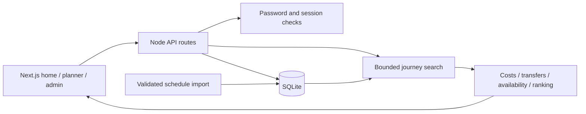

# Architecture and scope

## Problem and implemented solution

Travellers facing unavailable direct services need a complete journey that meets budget, arrival deadline, group-size and transfer constraints. RouteRush represents services as dated edges and terminal movements as explicit transfer rules. Its bounded search returns complete journeys with reasons when seats or transfers fail.

## Storage

The SQLite schema is created idempotently at first use:

- users: UUID, unique email, salted scrypt password hash.
- sessions: SHA-256 hash of a random session token, user reference, expiration.
- saved: UUID, owning user, original query, computed itinerary snapshot, created time.
- dataset: validated JSON services and transfer rules, last import time.
- attempts: email-level login/registration attempt count and expiration.

Dataset replacement is one SQL update. Saved-trip access is always filtered by the authenticated user on the server. The schema is deliberately compact for a single-server academic project. A production expansion should migrate services and transfer records into indexed relational tables and introduce versioned schema migrations.

## Routing

1. Parse and validate the search; departure date boundaries use India time.
2. Select services within a 72-hour search horizon and permitted transport modes.
3. Start at services departing on the requested day and matching the requested city or terminal.
4. Expand to connecting services at the same city only when an explicit terminal transfer exists. Limit connections to 12 hours and journeys to two transfers; do not revisit cities.
5. Calculate transfer slack = scheduled gap − terminal movement − boarding buffer.
6. Sum per-person fares multiplied by party size plus group transfer costs.
7. Exclude journeys exceeding the budget or full arrival deadline. Mark insufficient seats, unknown inventory, stale inventory and negative transfer slack as needing attention.
8. Rank usable journeys first, then by selected arrival/cost/duration/transfer priority, using price as a tie-breaker.

The algorithm is a bounded depth-first traversal rather than a claim of globally optimal nationwide routing. It limits exploration to 30,000 states and results to 100. Worst-case expansion grows with branching factor to the allowed leg count; wider coverage requires adjacency indexes and a multi-criteria label-setting algorithm. Missing transfer estimates prevent a connection from being generated.

## Authentication and boundaries

Passwords use scrypt with independent salts. Sessions use random 256-bit tokens, hashed at rest, expiring after seven days. Cookies are HttpOnly, SameSite=Lax and Secure in production. Mutating browser requests reject a different Origin. Login attempts are limited per email; a public deployment also needs infrastructure-level rate limiting. Admin access requires a server-configured bearer token, held only in page memory by the UI.

There is no email verification, password-reset mailer, payment flow, ticket reservation or automatic availability alert. These should not be represented as implemented features.

## Data integrity

Initial schedules are simulated and labelled throughout the planner. Imported inventory older than 15 minutes (or implausibly in the future) needs rechecking. This generic threshold is a conservative prototype rule, not a provider guarantee. Even fresh imported inventory cannot guarantee successful ticket purchase. The application keeps source and check time visible and uses provider handoff links.
